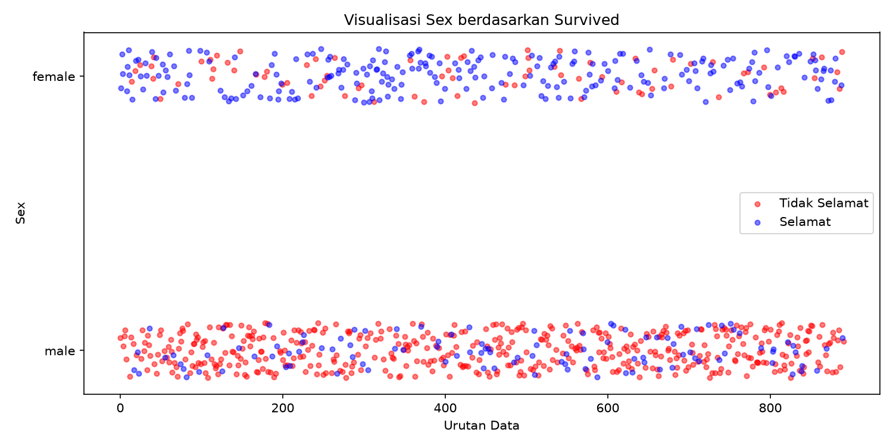
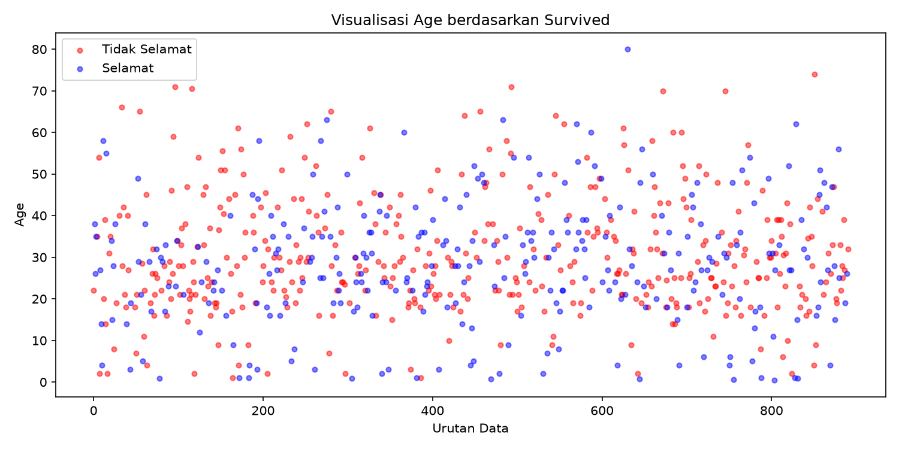
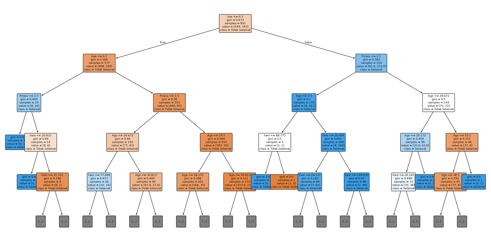

<div align="center">

# Data Mining Course

### Praktikum Data Mining — Preprocessing, Normalisasi, k-NN, Validation & Decision Tree

[](https://www.python.org/)
[](https://pandas.pydata.org/)
[](https://scikit-learn.org/)
[](LICENSE)

Kumpulan assignment mata kuliah **Data Mining** dengan dataset Titanic.  
Setiap topik dibagi menjadi file assignment kecil agar mudah dijalankan dan ditelusuri.

</div>

---

## Preview

| Distribusi penumpang | Distribusi umur | Struktur Decision Tree |
|:---:|:---:|:---:|
|  |  |  |

## Daftar Materi

| Folder | Topik | Highlight |
|---|---|---|
| [`Code/Data Manipulation & Visualisation`](Code/Data%20Manipulation%20%26%20Visualisation/) | Manipulasi & visualisasi data | Agregasi, fitur Relatives, plot Sex/Age |
| [`Code/Data Normalization`](Code/Data%20Normalization/) | Normalisasi fitur | Min-Max, Z-Score, Sigmoidal |
| [`Code/Classification`](Code/Classification/) | k-Nearest Neighbor | Uji k = 1..15 + error ratio |
| [`Code/Validation Model`](Code/Validation%20Model/) | Validasi model | Hold-Out, 10-Fold, Leave-One-Out |
| [`Code/Decision Tree`](Code/Decision%20Tree/) | Decision Tree | Klasifikasi Survived + hierarchy pohon |

## Struktur Repository

```text
data-mining-course/
├── assets/previews/              # Hasil plot untuk dokumentasi
├── Code/
│   ├── Classification/           # k-NN (assignment1–10)
│   ├── Data Manipulation & Visualisation/
│   ├── Data Normalization/
│   ├── Decision Tree/
│   └── Validation Model/
├── LICENSE
└── README.md
```

Setiap folder materi memiliki `README.md` tersendiri berisi daftar assignment.

## Dataset

Semua praktikum memakai data **Titanic** (varian `Titanic-Dataset.csv`, `titanic.csv`, `titanic_test.csv`, `titanic_testlabel.csv`).

## Cara Menjalankan

Prasyarat: Python 3.10+.

```bash
python -m venv .venv
# Windows
.venv\Scripts\Activate.ps1
# Linux/macOS
source .venv/bin/activate

python -m pip install pandas numpy matplotlib scikit-learn
```

Masuk ke folder materi lalu jalankan assignment:

```bash
cd "Code/Decision Tree"
python assignment1.py
```

Contoh lain:

```bash
cd "Code/Classification"
python assignment9.py
```

## Dependensi

| Library | Kegunaan |
|---|---|
| `pandas` | Manipulasi tabel / DataFrame |
| `numpy` | Operasi numerik |
| `matplotlib` | Visualisasi grafik |
| `scikit-learn` | Algoritma ML & metrik |

## Catatan Pembelajaran

- Missing value pada `Age` diisi rata-rata **per kelas** agar distribusi lebih adil.
- Normalisasi penting sebelum k-NN karena algoritma berbasis jarak.
- Decision Tree mudah diinterpretasikan (bisa divisualisasikan sebagai pohon).
- Validasi silang mengurangi bias estimasi akurasi dibanding split tunggal.

## Penulis

**Ahmad Nabah Falah** — [@ausartal](https://github.com/ausartal)
